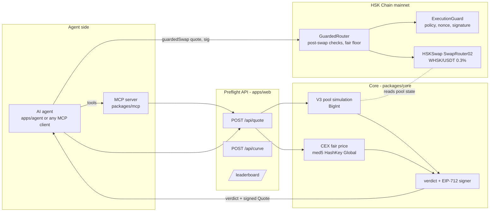

# Preflight

**Preflight tells AI agents what a swap will cost before they send it, and reverts on-chain when it exceeds their limits.**

Built for HSK Chain Horizon Hackathon (Seoul) — Track 1: AI Agent Trading.
Target: HSK Chain mainnet (chain id 177), HSKSwap (Uniswap V3) WHSK/USDT 0.3% pool `0x4ff515761864e7838B0AdB8b5b2B8B7A068905dC`.

| | |
|---|---|
| Live app | https://preflight-hsk.vercel.app — `/` landing, `/playground`, `/leaderboard` |
| Source | https://github.com/yhoyoex/preflight-hsk |
| `ExecutionGuard` | [`{{GUARD_ADDRESS}}`](https://hsk.blockscout.com/address/{{GUARD_ADDRESS}}) |
| `GuardedRouter` | [`{{ROUTER_ADDRESS}}`](https://hsk.blockscout.com/address/{{ROUTER_ADDRESS}}) |
| Guarded swap (success) | [{{TX_SUCCESS}}](https://hsk.blockscout.com/tx/{{TX_SUCCESS}}) |
| Guarded swap (revert) | [{{TX_REVERT}}](https://hsk.blockscout.com/tx/{{TX_REVERT}}) |

## The problem

An AI agent that can call `swap()` cannot see what the swap will cost. On HSK Chain the main WHSK/USDT pool looks deep (≈$839k TVL on 24 Nov 2026), but it is thin in practice:

- In 30 days it had only **2,136 swaps** and **≈$40.6k volume**; the largest swap was **$502**.
- A **$10k** market order costs **≈233 bps** of price impact on top of the 30 bps LP fee; **≈$4.24k** already reaches 100 bps.
- The DEX price drifts away from the CEX price (HashKey Global HSKUSDT): median |DEX − CEX| is **40 bps**.
- **Nobody arbitrages it back.** After a swap that moves the price ≥5 bps, **72% (18/25)** did not recover even 50% within 24 hours.

So an agent sizing trades from TVL, or splitting orders and expecting the price to come back, will overpay — silently.

## The solution

Preflight is an execution guard with two halves:

1. **Off-chain quote (attestor).** Before trading, the agent asks `POST /api/quote`. Preflight simulates the swap on the exact pool state (BigInt Uniswap V3 math), compares the pool spot price with a fair CEX price, and returns a **verdict** plus a cost breakdown (fee, impact, deviation, total in bps and USD, and the largest size that fits the agent's policy).
2. **On-chain enforcement.** For an executable `DEX` verdict the attestor signs an EIP-712 `Quote`. `GuardedRouter.guardedSwap` verifies it through `ExecutionGuard` and **re-checks the real outcome after the swap**. If the price moved between quote and execution (front-run, stale quote, oversized order) the transaction reverts with a decoded custom error — the agent pays gas, not slippage.

| Verdict | Meaning | Signed? |
|---|---|---|
| `DEX` | Cost is within policy; swap on HSKSwap | Yes (only with a fresh CEX price) |
| `CEX` | Impact ≥ 100 bps and notional ≥ $10k — a CEX/OTC venue may be cheaper | No |
| `TUNDA` (wait) | Pool spot deviates from the fair price by more than `maxDevBps` | No |
| `KECILKAN` (reduce size) | Impact exceeds `maxImpactBps`; response includes the max size that fits | No |
| `NO_REFERENCE` | No fresh CEX price; refuse to judge fairness | No |
| `OUT_OF_RANGE` | Order exhausts the pool's liquidity range | No |

## Architecture



```
contracts/        Foundry: ExecutionGuard, GuardConsumer, GuardedRouter, PriceMath (+ tests, script/Deploy.s.sol)
packages/core/    TypeScript (viem, BigInt): V3 pool simulation, CEX med5 price, verdict, EIP-712 signing, indexer
packages/mcp/     stdio MCP server: guard_quote, guard_check, guarded_swap
apps/web/         Next.js: landing, /playground, /leaderboard, POST /api/quote, POST /api/curve, GET /api/leaderboard
apps/agent/       Price-guard agent (med5 trigger + size_trade + Claude Haiku reasoning), executes via GuardedRouter
research/         Python backtest + arbitrage simulation (read-only evidence): REPORT.md, ARB_REPORT.md
docs/screens/     Screenshots
```

## How it works: quote → sign → guardedSwap

1. **Quote.** The agent calls `POST /api/quote` with `{agent, executor, zeroForOne | tokenIn, amountIn}`.
2. **Sign.** The attestor simulates the swap, reads the CEX price, applies the agent's on-chain policy (read from `ExecutionGuard`), returns a verdict, and — only for `DEX` with a fresh CEX price — signs a `Quote` (EIP-712, random 256-bit nonce). Otherwise `quote`/`signature` are `null`.
3. **guardedSwap.** The `executor` (`GuardedRouter`, a `GuardConsumer` contract, or the agent itself) submits
   `GuardedRouter.guardedSwap(quote, sig, amountOutMin, reasonHash)`:
   - `ExecutionGuard.verify`: attestor signature, executor, expiry, max age, nonce (marked used before external calls), quoted impact, spot deviation;
   - swap on HSKSwap;
   - post-swap checks: actual impact, post-swap deviation, and a **fair floor** — output must be ≥ `spotOut(fairSqrtPriceX96) × (1 − (maxDevBps + maxImpactBps)/10000)` regardless of the caller's `amountOutMin`, so a sandwich is bounded even with `amountOutMin = 0`.
   - Any failure reverts with a custom error (`DeviationTooHigh`, `ImpactTooHigh`, `ActualImpactTooHigh`, `PostSwapDeviationTooHigh`, `BelowFairFloor`, …).

Default policy per agent (changeable via `ExecutionGuard.setPolicy`): `maxImpactBps = 100`, `maxDevBps = 200`, `maxAge = 120 s`.
`reasonHash = keccak256(final reason)` records *why* the agent traded, on-chain.

### Definitions

- **impactBps** — execution cost vs. pre-trade spot, **excluding** the LP fee: `ceil((spotOut − amountOut) / spotOut × 10000)`, where `spotOut` is the output at spot after the 0.3% fee. Rounded up exactly like `PriceMath.impactBps`, so a quote that passes off-chain never reverts on rounding. `totalCostBps = feeBps + impactBps + adverseDevBps`.
- **devBps** — pool spot vs. fair price (median of the last 5 one-minute closes *with volume* on HashKey Global HSKUSDT; stale if no trade within 5 minutes).

### Verdict design notes

- **Direction-free deviation (fail-safe).** `spotDevFails` (`packages/core/src/verdict.ts`) and the on-chain spot check use `|devBps|`. A gap above `maxDevBps` (200) is always `TUNDA`, even if it favours the trade, because a CEX feed that far off is as likely wrong as the pool. With the agent's 100 bps trigger, only signals in the **100–200 bps** window can be signed.
- **CEX/OTC threshold.** `cexImpactBps = 100` uses `impactBps` — the same metric as the "impact cost" table in [`research/REPORT.md`](research/REPORT.md) (≥ $4,238 → ≥ 100 bps; core simulation at the fixture state: $4,251). It is *not* the per-swap "price move" metric, which is ≈ 2× `impactBps`. `CEX` also requires notional ≥ $10k, so orders of ~$4.25k–$10k get `KECILKAN`.

## Quickstart

Prerequisites: Node ≥ 22, pnpm, [Foundry](https://book.getfoundry.sh/) (`forge`, `anvil`, `cast`).

```sh
git clone https://github.com/yhoyoex/preflight-hsk preflight && cd preflight
pnpm install

# TypeScript: unit tests, replay of on-chain swap logs, TS↔contract cross-check, sign.ts vs contract on anvil
cd contracts && forge build && cd ..     # sign.ts anvil test uses contracts/out
pnpm -r test
pnpm -r typecheck

# Contracts
cd contracts
forge test                                                                   # unit (fork tests skipped)
forge test --fork-url https://mainnet.hsk.xyz --fork-block-number 30609500  # + mainnet fork tests
```

Optional: live-RPC tests `HSK_LIVE=1 pnpm -r test`. Regenerate the cross-check fixture:
`PREFLIGHT_EXPORT_FIXTURE=true forge test --fork-url https://mainnet.hsk.xyz --fork-block-number 30609500 --mt export`.

### Run the web app / API

```sh
cp .env.example apps/web/.env.local     # fill ATTESTOR_PRIVATE_KEY, GUARD_ADDRESS
cd apps/web
pnpm dev                                # http://localhost:3000
curl -X POST localhost:3000/api/quote -H 'content-type: application/json' \
  -d '{"agent":"0x…","executor":"0x…","zeroForOne":false,"amountIn":"50"}'
curl -X POST localhost:3000/api/curve -H 'content-type: application/json' -d '{"zeroForOne":false}'
```

- `POST /api/quote` requires `agent` and `executor` (addresses); the signed quote is bound to both.
- `/api/curve` is **POST only** with body `{"zeroForOne": boolean}` (no other fields); it returns the unsigned cost-vs-size curve ($50–$20k).
- `GET /api/leaderboard` returns the 30-day execution-cost table.

All variables are documented in [`.env.example`](.env.example). Without a deployed `GUARD_ADDRESS` the default policy is used.
Rate limit: 30 requests/min per IP (`RATE_LIMIT_PER_MINUTE`, optionally shared via Upstash Redis) → HTTP 429 + `retry-after`; the in-memory limiter also has a global cap of 300/min per instance. Client IP comes from `x-vercel-forwarded-for` / `x-real-ip` (set by the platform); behind another proxy the **last** `X-Forwarded-For` hop is used, never the spoofable first hop.

### Run the agent

```sh
cd apps/agent
AGENT_ADDRESS=0x… ROUTER_ADDRESS=0x… pnpm start --once        # dry-run (default): no transactions
AGENT_PRIVATE_KEY=0x… ROUTER_ADDRESS=0x… pnpm start --live      # loop every minute, executes via GuardedRouter
PREFLIGHT_E2E=1 pnpm test:e2e                                   # anvil fork 30609500: success, ImpactTooHigh, front-run
pnpm start --scenario revert --rpc http://127.0.0.1:8545        # front-run revert demo (anvil only)
```

Trigger: pool spot deviates > 100 bps from CEX med5. Size: research `size_trade` (max 50% of `AGENT_CAPITAL_USD`, default $100). With `ANTHROPIC_API_KEY`, Claude Haiku (`AGENT_LLM_MODEL`, default `claude-haiku-5-5`) picks a size inside that bound and writes a reason; without a key a deterministic fallback is used. The final reason includes the clamped size (`[final size X TOKEN]`); its hash goes on-chain and the full text goes to `AGENT_LOG` (JSONL). Transactions are sent only for signed `DEX` verdicts.

Live-mode safeguards: no send while the wallet has a pending tx; 120 s receipt timeout; `forceApprove`-style approvals; circuit breaker exits (code 2) after `AGENT_MAX_CONSECUTIVE_FAILURES` (default 3) failed ticks; Anthropic client with 15 s timeout and 1 retry.

#### Revert demo (front-run)

The attestor never signs a swap that breaks the limits, so an honest revert happens when **the price moves between quote and execution**:

1. The agent gets a signed `DEX` quote to buy with 50 USDT (CEX 1.5% above DEX). Simulation passes; the tx enters the mempool.
2. A bot with a higher tip buys ~$10k of WHSK first in the same block, pushing the pool price up several percent.
3. The agent's tx is still mined, but the guard reverts with **`DeviationTooHigh(325, 200)`**. The agent pays gas only — it does not buy at the pushed price.

Start a fork first (`anvil --fork-url https://mainnet.hsk.xyz --fork-block-number 30609500`). The script deploys local contracts, disables automine so both txs land in one block, and prints tx order, hashes and the decoded error. The e2e suite also forces an oversized signed quote, which reverts with `ImpactTooHigh` (e.g. `ImpactTooHigh(454, 100)`).

## MCP usage

Any MCP client (Claude Desktop, Claude Code, …) can use Preflight as tools:

| Tool | What it does | Sends tx? |
|---|---|---|
| `guard_quote` | `POST /api/quote` → verdict, impact, CEX deviation, total cost | No |
| `guard_check` | `eth_call ExecutionGuard.verify(quote, sig)` against the agent's on-chain policy; returns the decoded custom error | No |
| `guarded_swap` | Quote + unsigned `approve` and `GuardedRouter.guardedSwap` calldata | Only if `AGENT_PRIVATE_KEY` **and** `PREFLIGHT_EXECUTE=1` |

```sh
claude mcp add preflight \
  -e PREFLIGHT_API_URL=https://preflight-hsk.vercel.app -e GUARD_ADDRESS={{GUARD_ADDRESS}} -e ROUTER_ADDRESS={{ROUTER_ADDRESS}} \
  -- node /ABS/PATH/preflight/packages/mcp/bin/preflight-mcp.mjs
```

`guarded_swap` refuses notional above `PREFLIGHT_MAX_USD` (default $100) and `amountOutMin` below the quote's fair floor. Claude Desktop config and a `tools/list` smoke test: [`packages/mcp/README.md`](packages/mcp/README.md).

## Execution-cost leaderboard

`pnpm snapshot` writes [`apps/web/data/leaderboard.json`](apps/web/data/leaderboard.json) for 30 days (blocks 29,302,744–30,598,744) from the cached research data; RPC is only used to look up each tx's `from` (cached in `apps/web/data/tx_senders.json`). Indexer: [`packages/core/src/indexer.ts`](packages/core/src/indexer.ts).

Per swap: impact (ex-fee) from replaying the pre-swap state with the pool simulation, 30 bps fee, spot deviation vs. CEX med5 at that minute (null if stale); execution cost = fee + impact + deviation against the trade direction, aggregated per wallet. Snapshot: **2,136 swaps, 31 wallets, $40,651 volume, median cost 30.35 bps** (mostly the fee), fee + impact $126.51. It is labelled neutrally as "execution cost" — not as anyone's loss. Pages: `/leaderboard`, `/api/leaderboard`; if `ROUTER_ADDRESS` is set at snapshot time, `GuardedSwap` events are shown as a feed.

## Deployed contracts

| Contract | Address (HSK Chain mainnet, 177) |
|---|---|
| `ExecutionGuard` | [`{{GUARD_ADDRESS}}`](https://hsk.blockscout.com/address/{{GUARD_ADDRESS}}) |
| `GuardedRouter` | [`{{ROUTER_ADDRESS}}`](https://hsk.blockscout.com/address/{{ROUTER_ADDRESS}}) |
| HSKSwap SwapRouter02 (external) | `0x2c16f75b95Cf1390c328aB70e2CEE7f4b80bD8F3` |
| HSKSwap V3 Factory (external) | `0x972cA9D1662F5e029cD18327D29026532E84c742` |
| WHSK/USDT 0.3% pool (external) | `0x4ff515761864e7838B0AdB8b5b2B8B7A068905dC` |

**Testnet backup (chain 133, test Uniswap V3 pool, not HSKSwap):** ExecutionGuard [`0xF30860d72319B376D87503D2F8e725141Bb0CB5f`](https://testnet-explorer.hskchain.net/address/0xF30860d72319B376D87503D2F8e725141Bb0CB5f), GuardedRouter [`0x0e21210ED3630f8aEC74CF5Ae2CA73C2114921d6`](https://testnet-explorer.hskchain.net/address/0x0e21210ED3630f8aEC74CF5Ae2CA73C2114921d6), one [successful `guardedSwap`](https://testnet-explorer.hskchain.net/tx/0xb0d7f0651f39c467e5fa9dd7f5458a664760565c5b948eb4cb72579db5e3f38b) and one [reverted after a front-run](https://testnet-explorer.hskchain.net/tx/0xba7348a90dba847d552675840407dddb37cfa700018b5af610b3f3d2dd42e31d) (`DeviationTooHigh(480, 200)`). Details and caveats: [`docs/DEPLOYMENTS.md`](docs/DEPLOYMENTS.md).

Deploy: [`contracts/script/Deploy.s.sol`](contracts/script/Deploy.s.sol) (chain 177/133 only) reads `DEPLOYER_PRIVATE_KEY`, `ATTESTOR_ADDRESS` (required) and `GUARD_OWNER` from env; dry-run without `--broadcast` first. Ownership is two-step (`GUARD_OWNER` must call `acceptOwnership()`); renounce is disabled. Never commit private keys.

## Evidence

All numbers come from on-chain logs and public CEX klines, 2026-10-25 → 2026-11-24 (29.8 days). Details and method: [`research/REPORT.md`](research/REPORT.md), [`research/ARB_REPORT.md`](research/ARB_REPORT.md).

| Finding | Number | Source |
|---|---|---|
| Swaps / volume / largest swap (30 days) | 2,136 / ≈$40,651 / $502 | REPORT §Data |
| Impact cost of a single $10k / $50k order (ex-fee) | ≈233 bps / ≈1,065 bps | REPORT §Split |
| Order size reaching 30 / 100 bps impact | ≈$1,262 / ≈$4,238 | REPORT §Split |
| \|DEX − CEX\| median / p90 | 40 / 77 bps | REPORT §DEX vs CEX |
| Swaps ≥5 bps not recovering 50% within 24 h | 18/25 (72%) | REPORT §Recovery |
| Gaps ≥100 bps closed ≥50% by the DEX itself | 88/219 (the rest: CEX moved) | REPORT §DEX vs CEX |
| Savings from splitting an order (typical/median) | 0 | REPORT §Conclusion |
| Simulation vs. on-chain replay | 2,134/2,134 non-crossing swaps exact (+1/1 tick-crossing) | `packages/core/test/pool.test.ts` |
| TS impact vs. on-chain `PriceMath` | identical on fork fixture | `packages/core/test/crosscheck.test.ts` |

**Honest finding:** because nobody arbitrages the pool back, **splitting an order saves a median of 0** — so Preflight does *not* recommend splitting. It recommends `KECILKAN` (smaller size), `TUNDA` (wait), or `CEX` (another venue) instead.

## Limitations & trust model

- **Single trusted attestor.** The CEX reference price (HashKey Global HSKUSDT med5) is attested by one trusted signer. The on-chain guard bounds price impact and deviation *relative to that attested price*; it cannot detect a malicious or wrong attestor. Mitigations in place: short expiry/max age, nonces, on-chain policy per agent, attestor never uses DEX spot as the fair price when CEX is stale (`NO_REFERENCE`).
- **Thin CEX reference.** 61% of CEX minutes have no volume and the tick (0.0001) is ≈12 bps, so much of the DEX−CEX gap is CEX bid-ask bounce. That is why the fair price is a median of 5 traded minutes and stale data is refused.
- **Research is in-sample.** Backtests cover one 30-day window; best configurations were picked on the same data. The arbitrage agent is *not* robustly profitable (alpha positive in only 8/64 configurations) and is a demo of guarded execution, not a return claim.
- **Narrow signing window.** With the 100 bps trigger and `maxDevBps = 200`, the agent can only execute when the deviation is 100–200 bps.
- **One pool.** Only WHSK/USDT 0.3% on HSKSwap is supported today.

## Roadmap

- Multiple attestors / threshold signatures, and an on-chain oracle reference when one exists on HSK Chain.
- More pools and routing across HSKSwap fee tiers.
- Hosted MCP endpoint and an SDK for agent frameworks.
- Live `GuardedSwap` feed on the leaderboard after mainnet deployment.
